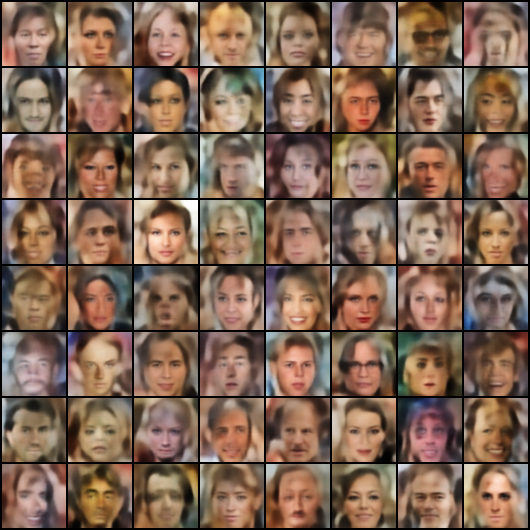
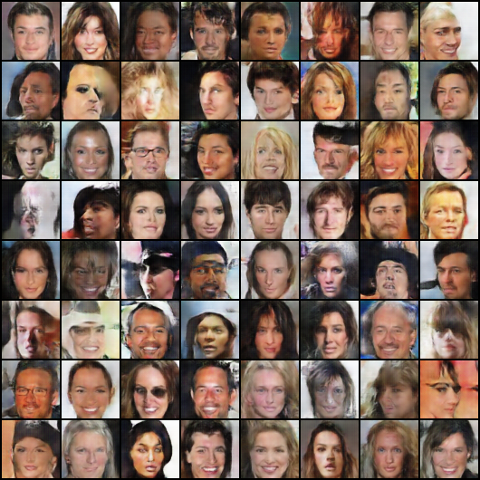
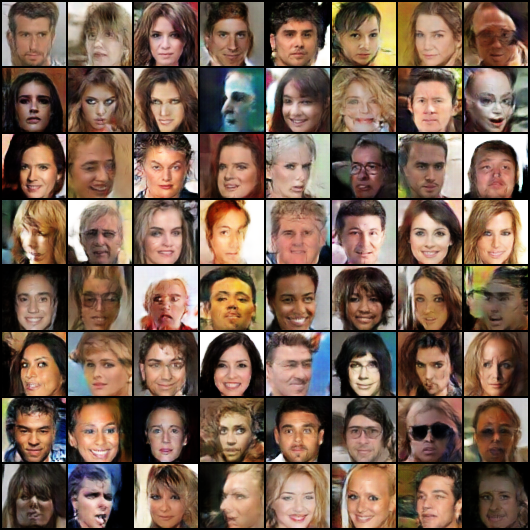
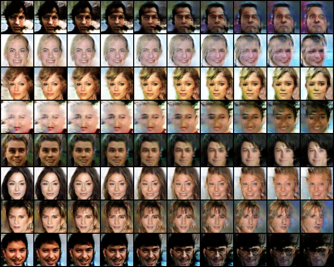
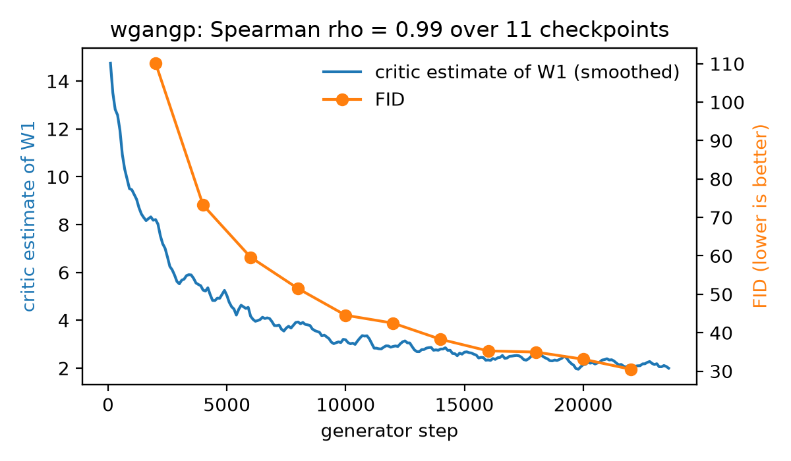
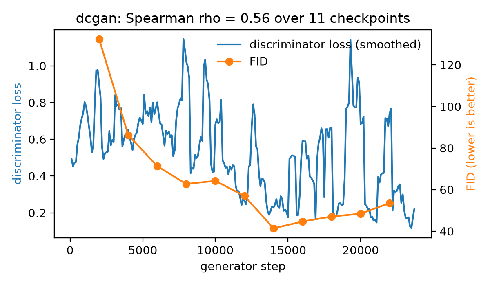
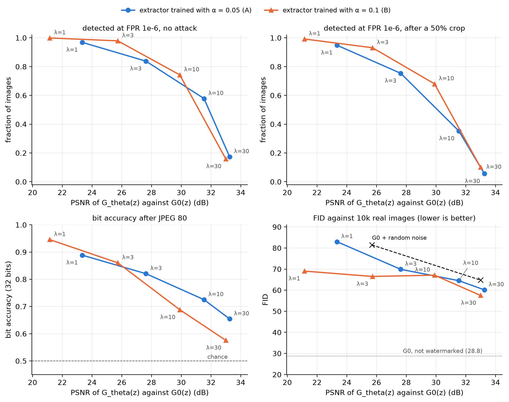
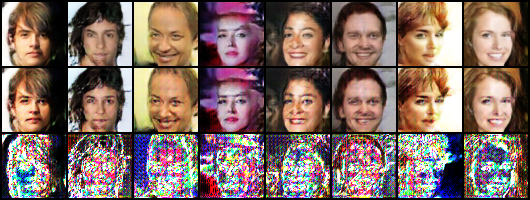
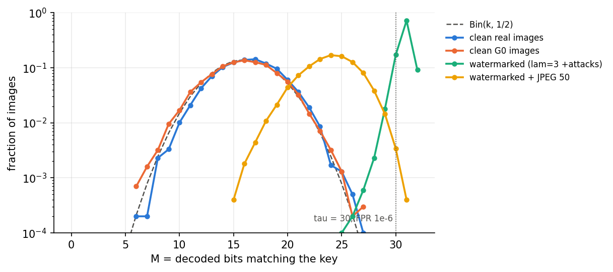

# Deep generative models on CelebA 64×64, and how to watermark them

From-scratch PyTorch implementations of a **VAE**, a **DCGAN** and a **WGAN-GP** trained on CelebA at 64×64 and evaluated with FID, followed by a small-scale reproduction of **Stable Signature** ([Fernandez et al., ICCV 2023](https://arxiv.org/abs/2303.15435)): the WGAN-GP generator is fine-tuned so that every image it produces carries an invisible 32-bit key, detected by a statistical test with an exact false-positive rate.

**Results at a glance**

- The WGAN-GP reaches **FID 28.8** (10,000 samples against 10,000 real images), against 60.4 for the DCGAN and 84.8 for the VAE.
- The WGAN-GP critic's estimate of the Wasserstein distance tracks sample quality: **Spearman ρ = 0.99** with FID over 11 checkpoints, against 0.56 for the DCGAN discriminator loss.
- The watermarked WGAN-GP has **98% of its images detected** at a false-positive rate of 10⁻⁶ (93% after a 50% crop), with **0 false alarms on 20,000 clean images**, at a PSNR of 25.7 dB. Its FID (66.5) is lower than that of the original generator plus random noise of the same PSNR (81.4).

## Part 1: generative models

| Model | Training | Generator steps | FID during training (at 22k steps) | FID, final model (10k samples) |
|---|---|---|---|---|
| VAE | 15 epochs | – | – | 84.8 |
| DCGAN | 15 epochs | 23.7k | 53.5 (best: 41.4 at 14k steps) | 60.4 |
| WGAN-GP | 75 epochs, 5 critic steps per generator step | 23.7k | 30.5 | **28.8** |

FIDs use [clean-fid](https://github.com/GaParmar/clean-fid). The two columns use different settings (number of samples and reference images), so compare numbers within a column only. The final-model FIDs are in [`results/fid_models.csv`](results/fid_models.csv), which also has a 10-epoch VAE (100.3).

| VAE | DCGAN | WGAN-GP |
|---|---|---|
|  |  |  |

Spherical interpolation between latent vectors of the WGAN-GP:



### Does the training signal track sample quality?

The WGAN-GP critic estimates the Wasserstein-1 distance between real and generated images, so it should fall as samples improve. Smoothing it and matching it with the FID checkpoints gives a Spearman correlation of **0.99** over 11 checkpoints (`analysis.py`). The DCGAN discriminator loss gives **0.56** (p = 0.07): its FID is best at 14k steps and then degrades while the loss keeps oscillating. The step-0 checkpoint is left out because the critic is untrained there (with it: 0.68 and 0.66). The points come from one training run, so the p-values are optimistic.

| WGAN-GP | DCGAN |
|---|---|
|  |  |

## Part 2: watermarking the WGAN-GP (Stable Signature at 64×64)

The goal is that every image sampled from the generator carries a fixed secret key of k = 32 bits, without any post-processing step, and that a detector can tell watermarked from non-watermarked images with a known false-alarm rate.

### How it works

1. **Train a reader (phase A).** A HiDDeN encoder ([Zhu et al., ECCV 2018](https://arxiv.org/abs/1807.09937)) hides random 32-bit messages in real CelebA images (each pixel moves by at most α), and an extractor W learns to read them back through random attacks: JPEG, crop, resize, Gaussian noise and brightness. The encoder is then thrown away.
2. **Whiten the reader.** A linear layer fitted on 10,000 clean images (real and generated) centres and decorrelates W's outputs, so that on non-watermarked images the 32 decoded bits behave like fair coin flips.
3. **Watermark the generator (phase B).** A copy of the generator is fine-tuned for 600 steps so that the frozen whitened extractor reads the secret key in its images: binary cross-entropy towards the key plus λ times the LPIPS distance to the original generator's image for the same latent. The images go through the same attacks during fine-tuning.
4. **Detect.** An image is flagged when at least 30 of the 32 decoded bits match the key. For a non-watermarked image the number of matches follows Bin(32, 1/2), so the false-positive rate of this threshold is exactly 1.2 × 10⁻⁷, below 10⁻⁶.

Two extractors were trained for 20 epochs on a Kaggle T4, with a differentiable JPEG gradient ([kornia](https://github.com/kornia/kornia)): **A** with α = 0.05 and **B** with α = 0.1. Each was used to watermark the generator with λ = 1, 3, 10 and 30.

### Quality–robustness frontier

Each point is one watermarked generator, evaluated on 10,000 fixed latents. Higher λ keeps the images closer to the original (higher PSNR) but makes the watermark weaker.



### Kept model: extractor B, λ = 3

PSNR 25.7 dB, LPIPS 0.068, FID 66.5. Rows: original images G₀(z), watermarked images G_θ(z) for the same latents, and 10 × the difference.



| Attack | Bit accuracy | Detected at FPR 10⁻⁶ | False alarms, 10k real photos | False alarms, 10k generated |
|---|---|---|---|---|
| none | 96.5% | 97.9% | 0 | 0 |
| crop to 50% of the area | 95.5% | 93.1% | 0 | 0 |
| Gaussian noise, σ = 0.05 | 86.5% | 12.6% | 0 | 0 |
| JPEG, quality 80 | 86.0% | 15.2% | 0 | 0 |
| JPEG, quality 50 | 74.8% | 0.4% | 0 | 0 |
| crop 50% + brightness ×1.5 + JPEG 80 | 70.6% | 0.3% | 0 | 0 |

**How the detector separates watermarked and clean images.** For any image, the detector decodes 32 bits and counts M, the number of them that match the secret key.

- **Clean images** (real photos, and images from the original generator G₀) carry no watermark. Their decoded bits are unrelated to the key, so each one matches by chance half the time, and M follows the binomial law Bin(32, ½) centred on 16 (dashed curve). They never reach the threshold of 30, hence no false alarms.
- **Green:** images from the watermarked generator (extractor B, λ = 3, fine-tuned through attacks). Almost all of them reach M ≥ 30 and are detected.
- **Yellow:** the same watermarked images after JPEG 50 compression. The compression flips some bits, and M drops to around 24, below the threshold.



### Findings

- **The extractor is the bottleneck.** With the first extractor (12 epochs, straight-through JPEG gradient), only 16% of the images were detected at λ = 3. Retraining it with the differentiable JPEG gradient and a longer schedule (extractor A) raised this to 84% at the same image quality (LPIPS 0.054).
- **FID at 64×64 is very sensitive to fine noise.** Adding invisible random noise to the original generator's images (PSNR 33 dB) already raises FID from 28.8 to 64.8. At the same PSNR, the watermarks cost less: 57.5 (B) and 60.1 (A) at 33 dB, and 66.5 against 81.4 at 25.7 dB.
- **JPEG robustness is limited by the resolution.** A 64×64 image holds only 64 JPEG blocks of 8×8 pixels, so an invisible watermark has to live in fine detail that JPEG removes. For the first extractor's watermark, only 8% of the signal survived JPEG 50 at 64×64, against 71% when the same images were upscaled to 256×256 before compression.
- **The detection test holds on data, approximately.** Whitening brings the variance of the number of matching bits on clean images from 4.9–6.0 to 7.3–8.9 (binomial value: 8). At the two looser thresholds that 10,000 clean images can measure (theoretical rates 3.5 × 10⁻³ and 2.7 × 10⁻⁴), the measured false-alarm rate is at most 2.2× the theoretical one, and at or below it for extractor A.

**Limitations:** single training runs (no variance over seeds), robustness to JPEG remains low at acceptable quality, and the false-positive rate of 10⁻⁶ is guaranteed by the binomial model, which the data only approximately follows.

## Reproducing

### Setup

```
pip install -r requirements.txt
```

Download the aligned CelebA images (202,599 jpgs, for example the Kaggle dataset `jessicali9530/celeba-dataset`) into `data/img_align_celeba/`. The images are not redistributed here; CelebA is available for non-commercial research purposes.

### Part 1

```
python train.py --out runs/vae --epochs 15
python train_gan.py --model dcgan --out runs/dcgan --epochs 15 --fid_real data/fid_real --fid_n 10000
python train_gan.py --model wgangp --out runs/wgangp --epochs 75 --fid_real data/fid_real --fid_n 10000
python model_interpolation.py --model wgangp --ck_path runs/wgangp/last.pt --interp s --len 10 --seed1 10 --seed2 20
python analysis.py --model wgangp
```

`--fid_real` saves 10,000 random real images (seed 0) and their clean-fid statistics `celeba64_ref`, used by every FID in this README; `--fid_every` sets how often FID is tracked during training.

### Part 2

All watermark scripts run from the repository root with `python -m`. For extractor B:

```
python -m watermark.train_hidden --out runs/wm/B/hidden --g_ckpt runs/wgangp/last.pt --alpha 0.1 --jpeg_grad kornia --epochs 16
python -m watermark.train_hidden --out runs/wm/B/hidden --g_ckpt runs/wgangp/last.pt --alpha 0.1 --jpeg_grad kornia --epochs 20 --lr 1e-4
python -m watermark.whiten --ckpt runs/wm/B/hidden/last.pt --g_ckpt runs/wgangp/last.pt
python -m watermark.finetune_gen --g_ckpt runs/wgangp/last.pt --wprime runs/wm/B/hidden/w_prime.pt --lam 1 3 10 30 --steps 600 --attack --jpeg_grad kornia --out runs/wm/B/finetune
python -m watermark.eval_wm --g_ckpt runs/wgangp/last.pt --wprime runs/wm/B/hidden/w_prime.pt --models "runs/wm/B/finetune/lam*/G_theta.pt" --keep runs/wm/B/finetune/lam3/G_theta.pt --n 10000 --fid --out runs/wm/B/eval
```

The second `train_hidden` call resumes from the first one with a 10× lower learning rate for the last 4 epochs. On a T4, phase A takes about 10 minutes per epoch; fine-tuning takes under a minute per λ on GPU and a few minutes on CPU. `python -m watermark.plot_logs runs/wm/B/hidden` plots the phase-A training curves, and `python -m watermark.plot_frontier` draws the frontier figure from [`results/fid_sweep.csv`](results/fid_sweep.csv). That file gathers the `eval_wm` results of every λ for both extractors (and the first one, `base`), the FID of every watermarked generator (computed with `eval_fid.fid_eval`, as for the kept model), and the noise control: the original generator plus Gaussian noise of a given PSNR.

Tests (a few seconds on CPU):

```
python -m watermark.test_hidden
python -m watermark.test_attacks
python -m watermark.test_whiten
```

## Repository structure

```
data.py                  CelebA 64x64 dataset (center crop, resize, pixels in [-1, 1])
models/                  VAE, DCGAN generator and discriminator (the WGAN-GP uses the same generator), weight init
losses.py                VAE, DCGAN and WGAN-GP losses, gradient penalty
train.py                 VAE training
train_gan.py             DCGAN and WGAN-GP training, FID tracked during training
eval_fid.py              FID with clean-fid
model_interpolation.py   linear and spherical latent interpolations
analysis.py              training signal against FID, Spearman correlation
test_eval.py             sanity check: FID between two halves of real images
watermark/
  hidden.py              HiDDeN encoder and extractor, whitened extractor
  attacks.py             train-time (differentiable) and evaluation attacks
  train_hidden.py        phase A: train the encoder and extractor
  whiten.py              whitening and check of the detection test on clean images
  detect.py              binomial test, threshold, secret key
  finetune_gen.py        phase B: fine-tune the generator for every λ
  eval_wm.py             quality and robustness evaluation, figures
  plot_logs.py           phase-A training curves
  plot_frontier.py       quality-robustness frontier figure
  test_*.py              unit tests
figs/                    figures used in this README
results/fid_models.csv   FID of the final VAE, DCGAN and WGAN-GP (10k samples)
results/fid_sweep.csv    watermark results behind the frontier figure
```

## References

- Kingma and Welling. [Auto-Encoding Variational Bayes](https://arxiv.org/abs/1312.6114). ICLR 2014.
- Radford, Metz and Chintala. [Unsupervised Representation Learning with Deep Convolutional GANs](https://arxiv.org/abs/1511.06434). ICLR 2016.
- Gulrajani et al. [Improved Training of Wasserstein GANs](https://arxiv.org/abs/1704.00028). NeurIPS 2017.
- Zhu, Kaplan, Johnson and Fei-Fei. [HiDDeN: Hiding Data With Deep Networks](https://arxiv.org/abs/1807.09937). ECCV 2018.
- Fernandez, Couairon, Jégou, Douze and Furon. [The Stable Signature: Rooting Watermarks in Latent Diffusion Models](https://arxiv.org/abs/2303.15435). ICCV 2023.
- Zhang, Isola, Efros, Shechtman and Wang. [The Unreasonable Effectiveness of Deep Features as a Perceptual Metric](https://arxiv.org/abs/1801.03924). CVPR 2018.
- Parmar, Zhang and Zhu. [On Aliased Resizing and Surprising Subtleties in GAN Evaluation](https://arxiv.org/abs/2104.11222). CVPR 2022.
- Liu, Luo, Wang and Tang. [Deep Learning Face Attributes in the Wild](https://arxiv.org/abs/1411.7766). ICCV 2015.
